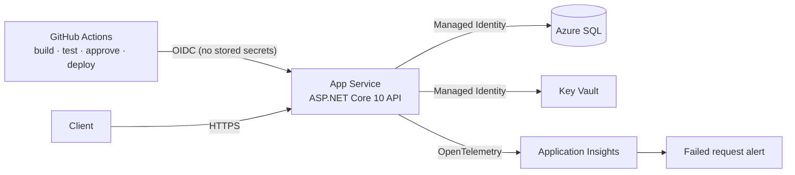

# Mini Obilet API

The core of a bus ticketing service: trip search, seat map, buying and cancelling tickets. The focus is on **never selling the same seat twice** and on shipping the app to **Azure with infrastructure as code and a passwordless CI/CD pipeline**.

**Live:** https://miniobilet-api-sj6smn.azurewebsites.net/api/v1/status

## Architecture



All Azure resources are created by `infra/main.bicep` in a single deployment. There are **no passwords** in code, config or GitHub:
- The app reaches SQL and Key Vault with its **Managed Identity**.
- Azure SQL accepts **Entra authentication only**. To keep the demo simple, the Entra admin is the app's own identity. In production it would be an Entra group, with the app granted only the roles it needs.
- GitHub Actions signs in to Azure with a **federated credential (OIDC)**. GitHub only stores non-secret ids as variables.

## API

| Method | Path | Description |
|---|---|---|
| GET | `/api/v1/trips?origin=İstanbul&destination=Ankara&date=2026-10-20` | Search trips with available seat counts |
| GET | `/api/v1/trips/{id}/seats` | Seat map |
| POST | `/api/v1/tickets` | Buy a ticket. `201`, or `409` if the seat is taken |
| GET | `/api/v1/tickets/{pnr}?email=...` | Get a ticket (PNR and email must match) |
| DELETE | `/api/v1/tickets/{pnr}?email=...` | Cancel (idempotent, `204`) |
| GET | `/health` | Health check including the database |
| GET | `/api/v1/status` | Environment, database, Key Vault and monitoring status |
| GET | `/openapi/v1.json` | OpenAPI document |

## Design decisions

| Topic | Decision | Why |
|---|---|---|
| Double booking | **Filtered unique index** on `(TripId, SeatNumber)` where `IsCancelled = 0` | An application-level check cannot separate two concurrent requests, and a `lock` only works inside one server. The database can. The second insert fails with `DbUpdateException` and the API returns `409`. Cancelled seats can be sold again |
| Access control | PNR **and** email required to read or cancel a ticket | Prevents reading someone else's ticket by guessing a PNR (IDOR). Returns `404`, not `403`, so it does not leak existence |
| Read queries | `AsNoTracking` + `Select` projection into DTOs | No N+1, only the needed columns |
| Transient faults | `EnableRetryOnFailure` | Connection drops on Azure SQL |
| Migrations | Applied on startup; the pipeline also produces an idempotent script as an artifact | Simple for a single instance. With multiple instances the script should run in the pipeline before deployment |
| Tests | `WebApplicationFactory` + SQLite, including a concurrency test (10 requests → 1 × `201`, 9 × `409`) | End to end through the real HTTP pipeline |

## Run locally

```bash
dotnet run --project src/MiniObilet.Api     # SQLite, sample trips are seeded automatically
dotnet test
```

## Deploy to Azure

```bash
az login
az group create -n rg-miniobilet-se -l swedencentral   # new free subscriptions may have 0 App Service quota in some regions
az deployment group create -g rg-miniobilet-se -f infra/main.bicep -p githubRepo=<owner>/mini-obilet \
  githubSubject="repo:<owner>@<ownerId>/mini-obilet@<repoId>:environment:production"   # new repos include GitHub ids
```

Then create a `production` environment in the GitHub repository and set these variables from the deployment outputs: `AZURE_CLIENT_ID`, `AZURE_TENANT_ID`, `AZURE_SUBSCRIPTION_ID`, `AZURE_WEBAPP_NAME`. Every push to `main` runs build, tests, an approval gate, the deployment and a `/health` smoke test.

## Known limitations

- The free App Service tier has no deployment slots or autoscale. On a paid tier the pipeline should deploy to a staging slot and swap.
- Seats are not held during payment. A real system needs a reservation with a TTL.
- No user authentication. A real system would use JWT/OIDC user accounts.
- Tests run on SQLite. Running them against SQL Server with Testcontainers would catch provider differences.
