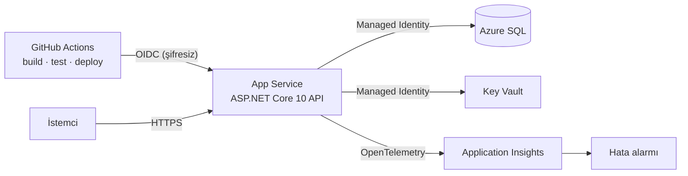

# Mini Obilet API

Otobüs bileti satışının çekirdeği: sefer arama, koltuk haritası, bilet alma ve iptal. Asıl odak, **aynı koltuğun iki kez satılmasını önlemek** ve uygulamayı **Azure'a kod olarak tanımlanmış altyapı ve şifresiz bir CI/CD hattıyla** yayınlamak.

## Mimari



Bütün Azure kaynakları `infra/main.bicep` ile tek komutla oluşturulur. Kodda, config'te ve GitHub'da **hiç şifre yok**:
- Uygulama SQL'e ve Key Vault'a **Managed Identity** ile bağlanır.
- SQL Server **sadece Entra kimlik doğrulaması** kabul eder. Demo sadeliği için Entra yöneticisi uygulamanın kendi kimliği (gerçek ortamda bir Entra grubu olur, uygulamaya sadece gereken roller verilir).
- GitHub Actions Azure'a **federated credential (OIDC)** ile girer. GitHub'da sadece gizli olmayan id'ler (değişken) tutulur.

## API

| Metot | Yol | Açıklama |
|---|---|---|
| GET | `/api/v1/seferler?kalkis=İstanbul&varis=Ankara&tarih=2026-10-20` | Sefer arama, boş koltuk sayısıyla |
| GET | `/api/v1/seferler/{id}/koltuklar` | Koltuk haritası |
| POST | `/api/v1/biletler` | Bilet al. `201`, dolu koltukta `409` |
| GET | `/api/v1/biletler/{pnr}?eposta=...` | Bilet sorgula (PNR + e-posta eşleşmeli) |
| DELETE | `/api/v1/biletler/{pnr}?eposta=...` | İptal (idempotent, `204`) |
| GET | `/health` | Veritabanı dahil sağlık kontrolü |
| GET | `/api/v1/durum` | Ortam, veritabanı, Key Vault ve izleme durumu |
| GET | `/openapi/v1.json` | OpenAPI tanımı |

## Tasarım kararları

| Konu | Karar | Neden |
|---|---|---|
| Çift satış | `(SeferId, KoltukNo)` üzerinde **filtreli unique index** (`WHERE Iptal = 0`) | Uygulamadaki kontrol iki eşzamanlı isteği ayıramaz, veritabanı ayırır. İkinci istek `DbUpdateException` alır, `409` döner. İptal edilen koltuk tekrar satılabilir |
| Erişim kontrolü | Bilet sorgu ve iptalde PNR + e-posta | Sadece PNR ile başkasının biletine erişilmesini (IDOR) önler |
| Okuma sorguları | `AsNoTracking` + `Select` ile DTO projeksiyonu | N+1 yok, sadece gereken kolonlar |
| Geçici hatalar | `EnableRetryOnFailure` | Azure SQL'de bağlantı kopmalarına karşı |
| Migration | Açılışta `Migrate()`, pipeline idempotent script'i artifact olarak üretir | Tek instance için basit. Çok instance'ta script pipeline'da, deploy'dan önce çalıştırılmalı |
| Test | `WebApplicationFactory` + SQLite, eşzamanlılık testi dahil (10 istek → 1 × 201, 9 × 409) | Gerçek HTTP pipeline'ı üzerinden uçtan uca |

## Lokal çalıştırma

```bash
dotnet run --project src/MiniObilet.Api     # SQLite ile, örnek seferler otomatik yüklenir
dotnet test
```

## Azure'a kurulum

```bash
az login
az group create -n rg-miniobilet-se -l swedencentral   # yeni ücretsiz hesaplarda bazı bölgelerde App Service kotası 0
az deployment group create -g rg-miniobilet-se -f infra/main.bicep -p githubRepo=<kullanıcı>/mini-obilet
```

GitHub deposunda `production` ortamı ve şu değişkenler tanımlanır (çıktılardan): `AZURE_CLIENT_ID`, `AZURE_TENANT_ID`, `AZURE_SUBSCRIPTION_ID`, `AZURE_WEBAPP_NAME`. `main`'e her push build, test, deploy ve `/health` smoke testini çalıştırır.

## Bilinen sınırlar

- Ücretsiz App Service katmanında deployment slot ve autoscale yok. Ücretli katmanda staging slot'a deploy edip swap yapılmalı.
- Koltuk ödeme süresince tutulmuyor (hold). Gerçek sistemde TTL'li bir rezervasyon kaydı gerekir.
- Kimlik doğrulama yok. Gerçek sistemde JWT/OIDC ile kullanıcı hesabı.
